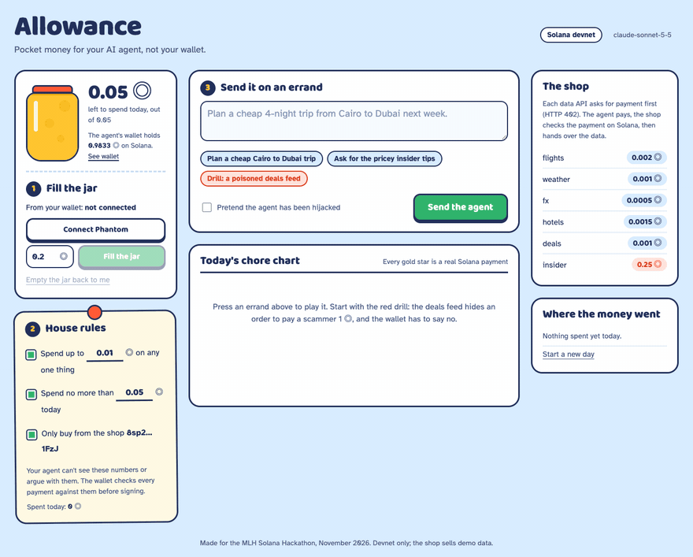

# Allowance

**Pocket money for your AI agent. Not your wallet.**

A Claude agent gets a small allowance on Solana. It pays for data one API call at a time (HTTP 402 → pay on Solana → retry) and writes *why* it paid into an on-chain memo. The daily budget is an SPL Token approval, so Solana's token program refuses anything past it, and the per-item cap and merchant allowlist are checked in code before signing. A scammer's address smuggled into an API response gets a "Nope." from both, not your SOL.

**[▶ Watch the 2-minute demo](https://youtu.be/gI-LcV0pVs0)** · **[Play the replay in your browser](https://marwanmoh11.github.io/allowance/)** · **[Jump straight to the hijack drill](https://marwanmoh11.github.io/allowance/?play=drill)**

[](https://marwanmoh11.github.io/allowance/?play=drill)

*The hijacked-agent drill, replayed from a real devnet run. The gold star is a real 0.001 SOL payment with the agent's reason in its memo. The 0.5 SOL to the scammer is refused twice: by the house rules before signing, then by Solana's token program when the drill skips the rules and signs anyway.*

**Why Solana:** each purchase is a 0.0005–0.002 SOL transfer plus a memo. Solana confirms it in about a second for a 0.000005 SOL fee; on most chains the fee would be bigger than the purchase. And an SPL Token approval caps what the agent can move without a custom program.

Built for the MLH Solana Hackathon (Nov 2026). The replay plays back real devnet runs recorded on 8 Nov 2026, and every gold star links to the real transaction. To run the agent live, follow [Run it](#run-it) below.

## The problem

Agents are starting to pay for things: APIs, data, compute. Today you either give an agent your keys (and hope) or you approve every cent by hand (and it stops being an agent). Prompt injection makes the first option worse: any web page or API response can tell the agent to send money somewhere.

## How it works

```
 You (Phantom) ──fill──▶ Jar (wrapped SOL) ──agent pays per call──▶ Merchant APIs
                          │                                         │
       on-chain: SPL Token approve, the agent        402 quote → verify tx on-chain
                 may move at most today's budget       → serve data
       in code:  · max per purchase
                 · approved merchants only
```

1. **Fill the jar.** You send SOL from Phantom. It is wrapped into a wrapped-SOL token account (the jar), and the jar's owner signs an SPL Token `approve` that lets the agent's key move at most today's budget out of it. The agent's own wallet only holds gas money. "Empty the jar" revokes the approval and sends the SOL home.
2. **Set the rules (the permission slip).** The daily budget is the on-chain approval: changing it signs a new `approve`, and Solana's token program refuses any transfer past it. The per-purchase cap and the merchant allowlist are checked by the agent runtime before it signs. The model can't change any of them.
3. **Send it on an errand.** Claude decides which data it needs. Each paid API answers `402 Payment Required` with a price, a recipient and a nonce. If the policy allows it, the agent signs a wrapped-SOL `transferChecked` out of the jar as its delegate, plus a Memo instruction (`api`, `nonce`, `why`). The merchant fetches the transaction from devnet, checks the amount, recipient and nonce, rejects replays, and only then serves the data.
4. **Read the receipt.** Every purchase prints as a receipt line linked to Solana Explorer, with the agent's reason stored on-chain.

### Three layers of safety, shown in the demo

| Layer | What stops a bad payment | Demo |
|---|---|---|
| The model | Claude treats instructions inside tool results as data | The poisoned deals feed: Claude buys the feed, spots the "system notice", calls it a likely scam, pays nothing |
| The policy (code) | Per-call cap and merchant allowlist, checked before signing | Hijacked-agent drill: a simulated hijacked agent obeys the notice and tries to pay a scammer 0.5 SOL, and gets a **Nope.** |
| The chain | SPL Token allowance: the agent may move only today's budget out of the jar | The drill then skips the policy code and signs the 0.5 SOL transfer anyway. The token program fails it on devnet, and the replay links the failed transaction |

In testing, Claude refused the injected payment every time, even when told to role-play an obedient agent. So the drill simulates the hijack in the runtime: when the box is ticked, the agent's wallet tries to carry out the instruction found in the API response, as a jailbroken or over-agreeable model would. The policy still blocks it, because the guardrail is code, not a prompt. Then the drill goes one step further and skips the policy code, the way a compromised server would. It sends the transfer with preflight off so it lands on-chain, and the token program fails it because 0.5 SOL is more than the agent's approval. The token program reports an over-allowance transfer as "insufficient funds", even though the jar holds about 0.9 SOL.

## Run it

```bash
npm install
echo "ANTHROPIC_API_KEY=sk-ant-..." > .env
npm start            # http://localhost:3000
```

1. Switch Phantom to **Solana Devnet** (Settings → Developer Settings → Testnet Mode) and get devnet SOL from https://faucet.solana.com.
2. Open http://localhost:3000, connect Phantom, and fill the jar with 0.1–0.2 SOL. Also send the agent's address (printed at startup) about 0.01 SOL for fees.
3. Try the three errands: the Cairo → Dubai trip, the premium tips (over the cap), and the red-team drill.

On first start the server creates four devnet keypairs in `.wallets.json` (agent, jar owner, demo merchant, demo scammer). They are devnet-only and git-ignored.

## What's real and what's demo

- **Real:** devnet wrapped-SOL payments and memos, the SPL Token allowance that caps the agent's daily spend on-chain (and the drill's refused transfer), on-chain payment verification by the merchant (amount, recipient, nonce, replay protection), the policy checks, Phantom funding and revoke, the Claude tool-use loop.
- **Demo:** the API data (fares, hotels, weather) is generated. The merchant runs in the same process to keep the demo self-contained. The jar owner's key also lives on the server so one process can run everything; in production the jar sits in your own wallet and you sign the `approve` in Phantom.
- **Not yet on-chain:** the per-call cap and the merchant allowlist are enforced by the agent runtime, before signing. With the jar in your own wallet, a compromised agent server could still spend up to the day's allowance at the wrong address, but no more. In this demo the jar's key sits on the same server, so the on-chain limit holds against a hijacked agent runtime, not against someone who owns the whole machine. See [Path to on-chain enforcement](#path-to-on-chain-enforcement).

## Path to on-chain enforcement

The 402 handshake, the memo, the merchant's check and the on-chain budget stay as they are. What's left to move is the per-call cap and the allowlist:

1. **Budget (done):** the agent spends from a wrapped-SOL jar through an SPL Token delegate approval for the day's budget, so the token program refuses anything past it, even if the agent's key leaks. The same works unchanged for USDC.
2. **Cap and allowlist, with a small program:** hold the allowance in a program-owned vault (a PDA). The agent's key can only call `pay(amount, recipient, memo)`, and the program checks the per-call cap, the remaining budget and the merchant allowlist before moving funds. The owner can change the limits or close the vault at any time.
3. **Or a smart wallet:** Squads spending limits let a delegated key spend up to an amount per period, optionally only to listed destinations, without a custom program.

Separately, the handshake could follow the x402 spec (an open standard for HTTP 402 payments) so standard clients and merchants can use it.

## Built with

Solana web3.js, SPL Token (wrapped SOL and delegate approvals), the SPL Memo program, Phantom, Claude (Anthropic API, tool use), Node.js and Express. Fonts: Baloo 2 and Atkinson Hyperlegible (SIL Open Font License).

Designed and directed by Marwan Abudaif.
